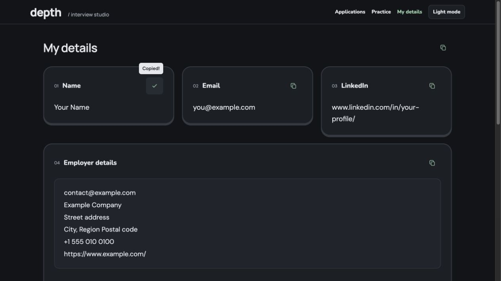

# Depth — Interview Studio

A reusable, personal-data-free website starter and design system. Share this GitHub repository with a friend: their ChatGPT or coding agent reads it and builds a studio for their own role, experience and accounts. The user does not need to understand Git or configure files.

## For the agent receiving this link

Read [START-HERE.md](START-HERE.md), [AGENTS.md](AGENTS.md) and [the setup contract](docs/AGENT-SETUP.md). Ask only the first stage question:

> What is your job profile, and how many years of experience do you have?

Build and show the homepage before asking for personal/employer details and résumé. Complete My Details before asking whether to connect Gmail. Do not present all stage questions together. Use default Cloudflare R2 storage; no database-selection questionnaire.

## What stays consistent

- Five palettes: Green, Blue, Purple, Amber and Grey; light and dark modes with neutral charcoal dark surfaces.
- Default, Playful and Calm style variants.
- DM Sans body text, Manrope headings, Nunito for selected playful treatments.
- Practice cards, detailed explanations, code samples, copy controls, signature blocks and application tracking.
- Responsive layout, readable typography, keyboard navigation, visible focus, reduced motion and icon-only copy buttons with animated checkmark feedback.

The starter includes a 50-question Java/Spring sample deck. Replace the content for another profession; preserve the design. My Details uses fictional placeholders, no résumé is bundled, and Applications starts empty.

## Agent map

- [START-HERE.md](START-HERE.md): first action and three-stage onboarding.
- [AGENTS.md](AGENTS.md): mandatory agent behavior and privacy boundaries.
- [docs/AGENT-SETUP.md](docs/AGENT-SETUP.md): implementation, data contracts, deployment and verified Gmail integration.
- [docs/DESIGN-SYSTEM.md](docs/DESIGN-SYSTEM.md): tokens, typography and component standards.
- [docs/UX-GUIDELINES.md](docs/UX-GUIDELINES.md): interactions and accessibility.
- [docs/UPGRADING.md](docs/UPGRADING.md): maintain and adopt future releases without replacing personal data.
- [theme/palettes.json](theme/palettes.json): generated palette tokens for all ten palette/mode combinations.
- [public/design-system.html](public/design-system.html): live visual reference using the actual stylesheet.



## Developer quick start

Node.js 22 or newer. No third-party npm dependencies or installation required.

```sh
npm start
# http://127.0.0.1:4180
npm run check
```

The local preview uses simulated owner identity and persists local applications in ignored `.local-data/`. It is a development tool, not a production login system. The production Worker is in `worker/index.mjs`; default persistence is R2. `npm run build` requires a new owner's `.openai/hosting.json` (see `hosting.example.json`) and creates `dist/`. Deploy using the current hosting environment's supported Sites workflow. Set `OWNER_EMAIL` in server-side hosting secret settings. Keep the Site private; never deploy the local preview server.

This repository does not automatically connect accounts or schedule Gmail ingestion. Provider consent, authenticated writer access, and an actual unattended read/write/readback test are required. A repository link cannot itself grant these capabilities.

## Template ownership and releases

This public template contains code, design assets and generic instructional content only. Each recipient owns a separate private deployment and their own accounts. Keep personal profile files, résumés, application records, provider tokens and live Site identifiers out of public commits.

See [CHANGELOG.md](CHANGELOG.md) for released design changes. Theme updates must preserve user content and use semantic versioning. The initial release is `v1.0.0`.
